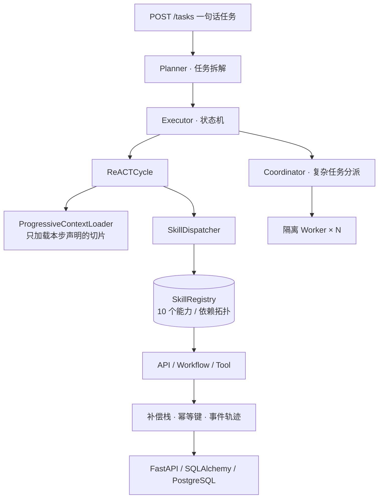

# digital-employee-runtime

> 面向**真实业务场景**的执行型数字员工运行时：
> `Task → Planning → ReACT → Tool/Skill 调用 → 输出`，**不是 RAG 问答系统**。

`Python 3.10+` · `FastAPI` · `SQLAlchemy` · `PostgreSQL/SQLite` · `Docker` · `Nginx` · `MIT`
## 为什么做这个

我在准备 Agent 应用开发实习时，发现大多数 demo 停在「检索一段政策然后念给你听」，
而真实售后场景要的是把退款办完：查单、核政策、动钱、发通知，中途挂了还得撤回去。
为了搞清这条链路怎么不重复扣钱、怎么逆序回滚，我把这个仓库跑通，
自己加了一个只读的保修校验能力，并完整走了一遍测试与 git 提交。

`25 tests passed` · `CI: Python 3.10 / 3.11 / 3.12`

一句话说明它做什么：客户发来一句「商品有质量问题，希望退款」，系统不会去检索一段答案，
而是**真的把它办完**——判类型、取订单、核政策、执行退款、写回复、发通知、留审计；
中途任何一步失败，已产生的副作用会被逆序撤销。

---

## 为什么做这个

问答式 Agent 的默认动作是「检索 → 塞进 prompt → 生成」。但数字员工面对的是**多步骤、
带副作用、要对钱负责**的任务，三个问题会立刻暴露：

1. 第 1 步需要的政策和第 6 步完全不同，一次性塞入既贵又稀释推理；
2. 工具调用失败后没有回滚，重试还可能造成二次退款；
3. 能力越加越多，编排层变成一堆 `if-else`，AI 生成的代码会扩散到核心链路。

这个项目用三个决策回答它们：**声明式 Skill Registry**、**Progressive Context**、
**幂等 + 补偿式执行链路**（见 `docs/adr/`）。

---

## 架构



分层红线与完整设计见 [`docs/architecture.md`](docs/architecture.md)。

---

## 快速开始

零配置即可跑通，不需要任何 API Key、数据库或外部服务：

```bash
pip install -e ".[dev]"
pytest -q                          # 24 passed
python scripts/demo.py             # 正常执行 + 失败回滚两个场景
python benchmarks/context_cost.py # 上下文开销对比
uvicorn der.api.main:app --reload # http://localhost:8000/docs
docker compose up --build         # PostgreSQL + App + Nginx(:8080)
```

常用接口：

| 接口 | 作用 |
|---|---|
| `POST /tasks` | 提交工单，返回执行状态与上下文报告 |
| `GET /tasks/{id}/trace` | 回放全量事件轨迹（审计用） |
| `POST /tasks/{id}/confirm` | 高危动作人工确认后按同一 task_id 重跑（幂等） |
| `GET /skills` | 给 Planner 的紧凑能力清单 |
| `POST /tasks/delegate` | 复杂任务走 Multi-Agent 协作 |

---

## 六个核心设计

### 1. Task Execution，而非信息问答
`Executor` 串起 Planning → ReACT → Skill 调用 → 输出，7 态状态机校验每一次转移，
每个状态变化、工具调用、补偿动作都写成可回放的 `Event`。

### 2. Skills 体系（能力模块化）
每个能力用 `SkillSpec` 声明 `kind` (API/Workflow/Tool)、`required_context`、
`produces`、`depends_on`、`retryable`、`compensatable`、`risk`。
`SkillRegistry` 负责版本、依赖拓扑排序、健康检查与给 Planner 的裁剪清单。
新增能力只改 `skills/builtin/`，编排层零改动。

### 3. 渐进式上下文（Progressive Context）
知识切成 12 个 `ContextSlice`，每个 Skill 只声明本步骤需要哪几片；
超预算时压缩并留痕，工具完整返回落 `artifacts`，**只有摘要进入下一轮推理**。
未知切片 id 直接抛错，不静默降级。对照实现 `context/baseline.py` 仅用于度量。

### 4. Planning / ReACT / 异常处理
`Planner` 只看裁剪后的能力清单；`ReACTCycle` 记录 Thought / Action / Observation；
异常被归类为 `RetryableError`（指数退避）、`NonRetryableError`（立即失败）、
`NeedsHumanError`（转人工）。高危 Skill 由**执行器**强制拦截等确认，不靠模型自觉。

### 5. 幂等、重试、逆序补偿回滚
带副作用的 Skill 必须返回 `compensation` 闭包并使用 `idempotency_key`。
下游通知失败时，退款单被撤销、未投递的话术被清除；
人工确认后按同一 task_id 重跑不会重复退款、不会重复触达客户。

### 6. Multi-Agent（按需启用）
`Coordinator` 仅在任务确实复杂时把子任务派给隔离 `Worker`
（各自独立的上下文加载器、状态与记忆），单分支失败不阻塞其他分支，最终聚合或降级。
RAG / GraphRAG 只是可选辅助 Skill，不参与核心决策。

---

## 上下文开销对比（实测）

`python benchmarks/context_cost.py`，12 片知识、8 步退款链路：

| 方案 | 单步 | 8 步合计 |
|---|---|---|
| 一次性塞入（传统 RAG） | 1069 tokens | **8552 tokens** |
| 渐进式按阶段加载 | 最大 304 tokens（占全量 28.4%） | **1300 tokens** |

**上下文成本下降 84.8%**，且每一步的输入可复现、可审计。
口径：N 步 ReACT 每轮都要重新携带全量上下文，故传统做法总成本 ≈ 单步全量 × N。
token 为轻量估算（CJK 1 字≈1 token，其余 4 字符≈1 token），同口径相对比较；
接入真实模型后可替换为 tiktoken。

---

## 与岗位要求的对应

| 要求 | 本仓库里的证据 |
|---|---|
| 完整 Agent 系统经验（非仅 RAG 问答） | `runtime/executor.py` 全链路 + 售后工单真实场景 |
| Skills / Tool 调用机制、Skill Registry | `skills/registry.py`、`skills/base.py`、10 个内置 Skill |
| Progressive Context、控制成本与稳定性 | `context/progressive.py` + `benchmarks/context_cost.py` |
| Planning / ReACT / 多步骤执行 / 异常处理 | `runtime/planner.py`、`react.py`、`domain/errors.py` |
| Multi-Agent 协作 | `multi_agent/coordinator.py` + 隔离 Worker |
| RAG / GraphRAG 作为辅助（非核心） | `skills/builtin/auxiliary.py::KnowledgeLookup` |
| AI Coding 完成系统开发、可维护代码体系 | `CLAUDE.md`、`.cursorrules`、`docs/ai-coding-workflow.md`、ADR |
| Python + 后端 + 系统设计（Agent/Skill/Memory 解耦） | `api/`、`runtime/memory.py`、`docs/architecture.md` |
| 工程习惯（日志 / 调试 / 异常处理 / 大规模 AI 代码） | 结构化日志、事件轨迹、24 个测试、CI 三版本矩阵 |
| 阅读 Claude Code / Hermes Agent 源码 | `docs/source-reading-notes.md`（含取舍分析） |
| Docker / Nginx / PostgreSQL / MySQL / Java 标签 | `docker-compose.yml`、`nginx/`、`persistence/`、HTTP Skill 适配契约 |

---

## 目录结构

```
src/der/
├── domain/         纯 dataclass：Task / Plan / Step / Event / ExecutionState / 异常体系
├── skills/         BaseSkill 契约、SkillRegistry、Dispatcher、10 个业务能力
├── context/        ContextSlice / Budget / ProgressiveLoader / Eager 对照实现
├── runtime/        Planner / ReACT / Executor / State / Memory / LLM Provider
├── multi_agent/    Bus / Coordinator / 隔离 Worker
├── api/            FastAPI 协议层
└── persistence/    SQLAlchemy（SQLite ↔ PostgreSQL 只改 DATABASE_URL）
docs/               架构、ADR、源码研读笔记、AI Coding 工作流
tests/              24 个用例：Registry / 上下文 / 回滚 / 重试 / ReACT / API / Multi-Agent
benchmarks/         上下文开销量化
scripts/demo.py     一键演示正常执行与失败回滚
```

---

## AI Coding 是怎么被管理的

仓库把 AI coding agent 当**协作开发者**：契约先行（`domain` + `BaseSkill` + ADR），
分层红线让「业务代码顺手读数据库 / 塞全量 prompt」变成结构性不可能；
生成结果按 `CLAUDE.md` 验收清单人审，commit 标注 `Co-authored-by: AI` 便于按来源复审。
细节见 [`docs/ai-coding-workflow.md`](docs/ai-coding-workflow.md)。

---

## 路线图（未实现，明确标注）

- [ ] Proactive Agent：由事件/定时触发，而非只响应请求
- [ ] Long-term Memory：FTS5 + LLM 摘要的跨会话召回与质量评估
- [ ] Context Engineering：按任务类型自动选择切片与压缩策略
- [ ] GraphRAG：把 `ContextSlice` 的图元数据真正用起来
- [ ] Skill 组合的并行调度与更细粒度的预算分配

## 验证记录

```
pytest -q  →  24 passed
python scripts/demo.py  →  场景 A succeeded / 场景 B rolled_back，退款单数量不变
python benchmarks/context_cost.py  →  8552 → 1300 tokens，-84.8%
```

## License

MIT
